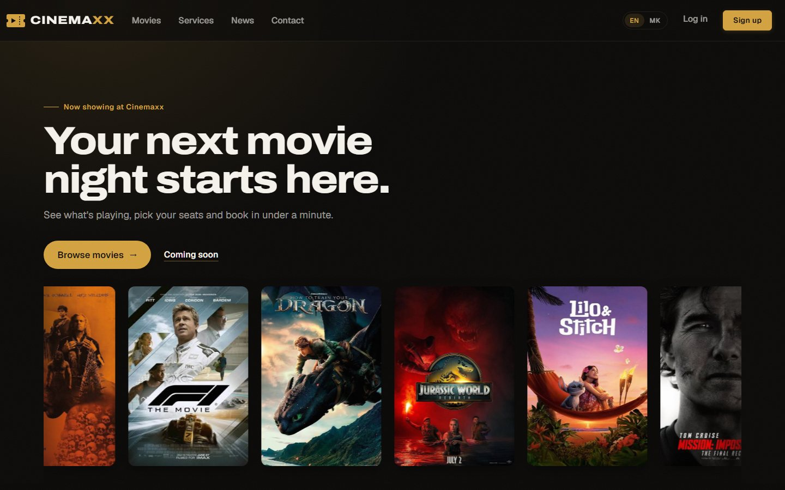
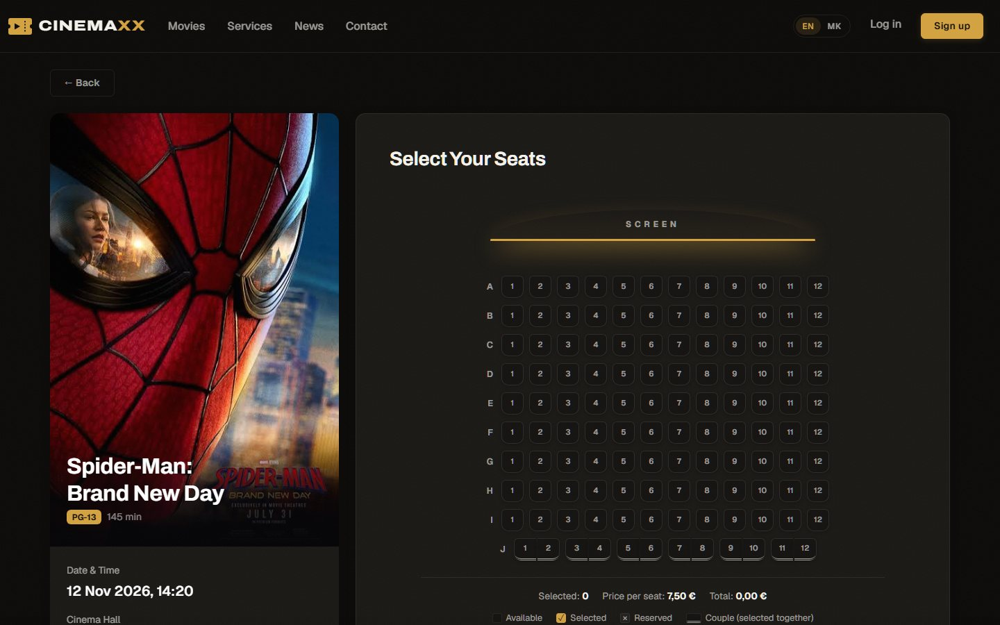

# Cinemaxx

A cinema booking website built with ASP.NET Core MVC. Visitors browse what's playing, pick seats on a live seat map and pay to confirm. Admins manage movies, screenings, halls, news and messages. The whole site is available in English and Macedonian.





## Features

- **Movies and showtimes**: filter by status, genre, language and day; movie pages with trailer, cast and screenings
- **Seat selection**: seat map per hall, couple seats that are selected together, live price total
- **Booking flow**: seats are held for 10 minutes while you pay; guests get a secure link to their booking
- **Accounts**: register, log in, see and cancel your reservations
- **Admin area**: dashboard, CRUD for movies, screenings, halls, genres, employees, news and services, plus a contact inbox
- **English and Macedonian**: switch language from the navbar; your choice is remembered in a cookie

## Tech stack

- .NET 10, ASP.NET Core MVC + Razor Pages (Identity)
- Entity Framework Core with SQLite
- Bootstrap 5 with custom CSS
- xUnit tests in `CinemaWebsite.Tests`

## Getting started

Requirements: [.NET 10 SDK](https://dotnet.microsoft.com/download).

```bash
dotnet run --project CinemaWebsite
```

On first start the app applies migrations and seeds sample movies, halls, screenings and a development admin account (see `CinemaWebsite/Data/DatabaseSeeder.cs`). The database is a local `app.db` file.

Run the tests:

```bash
dotnet test
```

A `Dockerfile` is included; the container listens on port 8080.

## Localization

All UI text goes through a shared localizer. The English text is the key, so English needs no resource file, and Macedonian lives in `CinemaWebsite/Resources/SharedResource.mk.resx`.

- In views: `@L["Browse movies"]`, or with values: `@L["{0} seats", hall.Capacity]`
- In controllers: inject `IStringLocalizer<SharedResource>`
- Long pages can have a culture-specific view instead, for example `Views/Home/Privacy.mk.cshtml`

To add a language, add its culture in `Program.cs`, create `SharedResource.<culture>.resx` and add it to `_LanguageSwitcher.cshtml`.

## Project structure

```
CinemaWebsite/
  Controllers/    MVC controllers
  Services/       reservation and screening logic
  Models/         EF Core entities
  ViewModels/     view-specific models
  Views/          Razor views
  Areas/Identity/ login, register and account pages
  Resources/      translations
  wwwroot/css/    site, home, booking, seat map and auth styles
CinemaWebsite.Tests/
```

## Authors

Built by [Asan](https://github.com/asanaliov) and [Mila Bozhinoska](https://github.com/milicabobica) as a team project.
